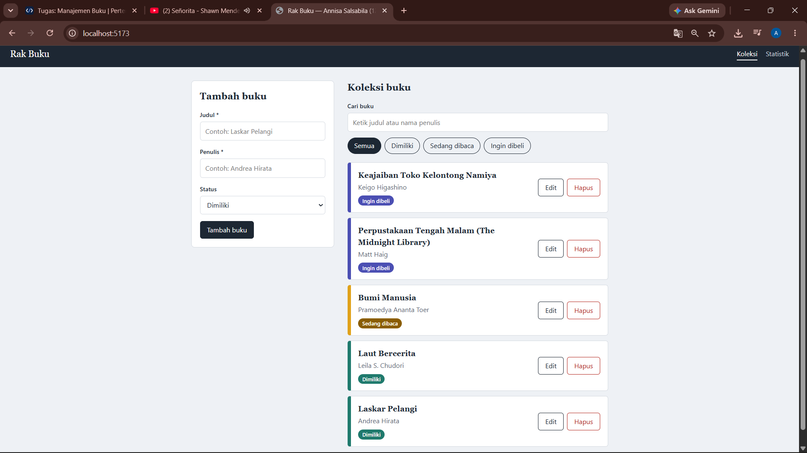
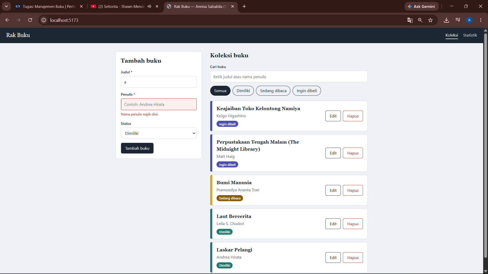
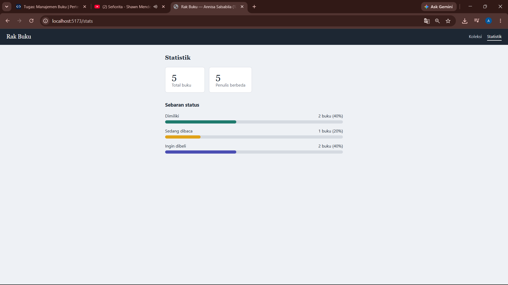
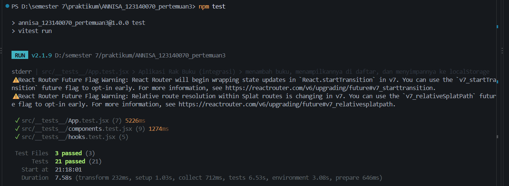

# Rak Buku — Aplikasi Manajemen Buku Pribadi

Tugas Praktikum Pemrograman Aplikasi Web (PAW) — Pertemuan 3: React Basics
Nama: **Annisa Salsabila** · NIM: **123140070** · Kelas: **RA**

## Deskripsi Aplikasi

Rak Buku adalah aplikasi untuk mencatat buku yang **dimiliki**, **sedang dibaca**, atau **ingin dibeli**.
Data disimpan di `localStorage` sehingga tetap ada setelah halaman ditutup atau dimuat ulang.

### Fitur
- Tambah buku baru (judul, penulis, status: milik / baca / beli)
- Edit dan hapus buku
- Filter buku berdasarkan status
- Pencarian berdasarkan judul atau nama penulis
- Halaman statistik (total buku, jumlah penulis, sebaran status)
- Validasi form: judul dan penulis wajib diisi, dengan pesan error dan penanda visual (border merah) pada kolom kosong

## Instalasi dan Cara Menjalankan

Prasyarat: Node.js 18 atau lebih baru.

```bash
# 1. Masuk ke folder project
cd ANNISA_123140070_pertemuan3

# 2. Pasang dependensi
npm install

# 3. Jalankan aplikasi (development)
npm run dev
```

Buka alamat yang tampil di terminal (biasanya http://localhost:5173) di browser.

Perintah lain:

| Perintah | Fungsi |
| --- | --- |
| `npm test` | Menjalankan seluruh unit test (Vitest + React Testing Library) |
| `npm run test:watch` | Menjalankan test dalam mode watch |
| `npm run build` | Membuat build produksi |

## Screenshot

> Ganti file di folder `docs/` dengan screenshot asli dari aplikasi Anda.

| Halaman | Gambar |
| --- | --- |
| Koleksi (Home) |  |
| Validasi form |  |
| Statistik |  |
| Hasil unit test |  |

## Fitur React yang Digunakan

| Konsep | Lokasi |
| --- | --- |
| Functional components | Seluruh komponen di `src/components` dan `src/pages` |
| `useState` | `BookForm` (nilai form & error), `Home` (buku yang diedit), `BookContext` (filter, pencarian) |
| `useEffect` | `useLocalStorage` — menyimpan data ke localStorage setiap berubah |
| `useMemo` / `useCallback` | `BookContext` (hasil filter & fungsi CRUD), `useBookStats` |
| Context API | `src/context/BookContext.jsx` — state buku, filter, dan aksi CRUD dibagikan ke seluruh halaman lewat `useBooks()` |
| React Router | `App.jsx` (`Routes`/`Route`), `Navbar` (`NavLink`), halaman `/` dan `/stats` |
| Custom hooks | `useLocalStorage` dan `useBookStats` di `src/hooks` |
| Komponen reusable | `BookForm`, `BookFilter`, `BookList`, `BookItem`, `Navbar` |
| Controlled components | Semua input pada `BookForm` dan `BookFilter` |
| Conditional rendering | Pesan error form, pesan daftar kosong, mode tambah/edit, halaman statistik kosong |
| Rendering list & `key` | `BookList` (key = id buku), `Stats` |
| Props & PropTypes | Seluruh komponen memiliki `propTypes` |

## Struktur Folder

```
src/
├── components/
│   ├── BookForm/    BookForm.jsx, BookForm.css
│   ├── BookList/    BookList.jsx, BookList.css
│   ├── BookItem/    BookItem.jsx, BookItem.css
│   ├── BookFilter/  BookFilter.jsx, BookFilter.css
│   └── Navbar/      Navbar.jsx, Navbar.css
├── pages/
│   ├── Home/        Home.jsx, Home.css
│   └── Stats/       Stats.jsx, Stats.css
├── hooks/           useLocalStorage.js, useBookStats.js
├── context/         BookContext.jsx
├── constants/       status.js
├── __tests__/       hooks.test.jsx, components.test.jsx, App.test.jsx
├── App.jsx
└── main.jsx
```

## Testing

Test ditulis dengan Vitest dan React Testing Library (21 test), mencakup:
- custom hooks (`useLocalStorage`, `useBookStats`)
- validasi dan perilaku `BookForm`
- `BookFilter`, `BookList`, `BookItem`
- alur lengkap aplikasi: tambah, edit, hapus, filter, cari, persistensi localStorage, dan navigasi

Jalankan dengan `npm test`, lalu ambil screenshot hasilnya di terminal untuk laporan.
