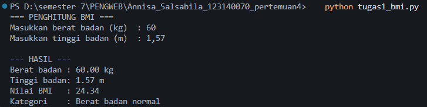
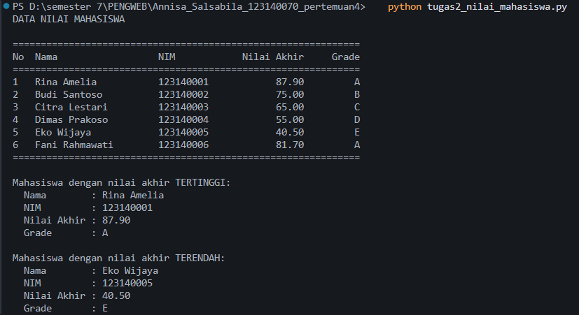
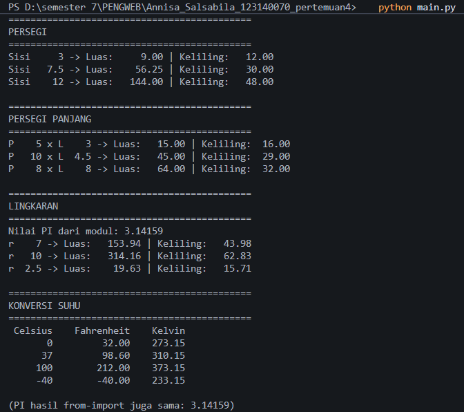

# Praktikum Pengembangan Aplikasi Web - Pertemuan 4 (Python Dasar)

## Identitas

| | |
|---|---|
| Nama | Annisa Salsabila |
| NIM | 123140070 |
| Program Studi | Teknik Informatika, ITERA |

## Isi Folder

```
Annisa_Salsabila_123140070_pertemuan4/
├── .gitignore
├── README.md
├── tugas1_bmi.py
├── tugas2_nilai_mahasiswa.py
├── math_operations.py
├── main.py
└── screenshots/
```

## Cara Menjalankan

Pastikan Python 3.8 ke atas sudah terpasang (cek dengan `python --version`),
lalu buka terminal di dalam folder ini (di VS Code bisa pakai `Ctrl + ``).

```bash
python tugas1_bmi.py
python tugas2_nilai_mahasiswa.py
python main.py
```

Kalau di komputer tertentu perintah `python` tidak dikenali, ganti dengan
`python3`. File `math_operations.py` tidak perlu dijalankan sendiri karena
dipanggil lewat `main.py`.

## Penjelasan Program

### Soal 1 - Penghitung BMI (`tugas1_bmi.py`)

Program meminta berat badan (kg) dan tinggi badan (m) lewat `input()`.
Input dicek dulu: harus angka, harus lebih dari 0, dan tinggi tidak boleh
lebih dari 3 meter (biar kalau kita salah ngetik pakai cm, misalnya 170,
program langsung minta diulang). Setelah itu BMI dihitung dengan rumus
`berat / (tinggi * tinggi)` dan kategorinya ditentukan pakai `if-elif-else`:

| BMI | Kategori |
|---|---|
| < 18.5 | Berat badan kurang |
| 18.5 sampai < 25 | Berat badan normal |
| 25 sampai < 30 | Berat badan berlebih |
| >= 30 | Obesitas |

Hasil BMI ditampilkan dengan 2 angka desimal memakai f-string.

### Soal 2 - Pengelolaan Nilai Mahasiswa (`tugas2_nilai_mahasiswa.py`)

Data 6 mahasiswa disimpan di list berisi dictionary (kunci: `nama`, `nim`,
`nilai_uts`, `nilai_uas`, `nilai_tugas`). Alurnya:

1. Hitung nilai akhir: `30% * UTS + 40% * UAS + 30% * Tugas`.
2. Tentukan grade A sampai E sesuai rentang nilai di soal.
3. Cetak tabel (No, Nama, NIM, Nilai Akhir, Grade) dengan perataan f-string.
4. Cari nilai akhir tertinggi dan terendah memakai `max()` dan `min()`
   dengan `key=lambda`.

Data dummy sengaja dibuat supaya kelima grade (A sampai E) muncul semua,
jadi semua cabang percabangan ikut teruji.

### Soal 3 - Modul Matematika (`math_operations.py` dan `main.py`)

`math_operations.py` berisi:

- konstanta `PI = 3.14159`
- luas dan keliling persegi, persegi panjang, dan lingkaran
- konversi suhu Celsius ke Fahrenheit dan Celsius ke Kelvin

`main.py` mengimpor modul tersebut dengan dua cara:

- `import math_operations` untuk fungsi geometri (dipanggil
  `math_operations.luas_persegi(...)`)
- `from math_operations import celsius_ke_fahrenheit, celsius_ke_kelvin, PI`
  untuk fungsi suhu dan konstanta

Semua fungsi dipanggil dengan beberapa nilai uji, dan hasilnya dicetak rapi
dalam bentuk tabel di terminal.

## Screenshot Hasil Eksekusi

### Soal 1 - BMI


### Soal 2 - Nilai Mahasiswa


### Soal 3 - Modul Matematika

